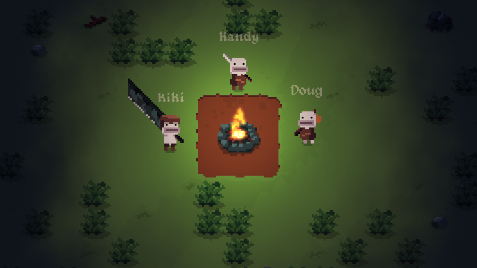

Ayo!

The first major update is out now on the experimental branch for early testing.

It adds multiplayer and a full open world survival crafting experience.

**NOTE - full instructions for how to opt-in are in the [Discord](https://discord.gg/JePvX8VUyP) if you're not familar with Steam's beta branch feature.**

Press F9 in game to tell me what you think, or find me in the [Discord](https://discord.gg/JePvX8VUyP).

## What's new

- Multiplayer with proximity chat
- Full open world overhaul[^legacy]
- Controller support (still experimental)
- Expand into The Wasteland with a new Terraforming system
- New research system, designed to allow for progression tied to the base itself, not your character
- Melt and pour metal with a Foundry
- Gear up with armor and trinkets to face new enemies
- A rare Bloodmoon event and base defense measures
- Climb the Copper, Iron and Steel Ages in service of The Hole
- Language translations for Simplified Chinese, German, French, Japanese, Korean, Thai, Russian, Brazilian Portuguese, Latin American Spanish, and Polish

[^legacy]: Note - Previous v0.27 worlds will still be playable on the Legacy branch if you want to revisit them. But as you can imagine with a massive redesign like this, the old worlds had to be deprecated.

## Multiplayer Tribes

Designed for parallel progression with multiple people existing in the one world.

Each player gets their own island when spawning in. You can choose to progress at your own pace, team up with a friend and move to their island, or anything in between.

This allows up to ~16 people on the one world for larger SMP style community servers.

## What's changed

- Basically everything.

TL;DR - The whole game has been redesigned from the ground up to support multiplayer and it being open world.

Enjoy!

*-randy*
